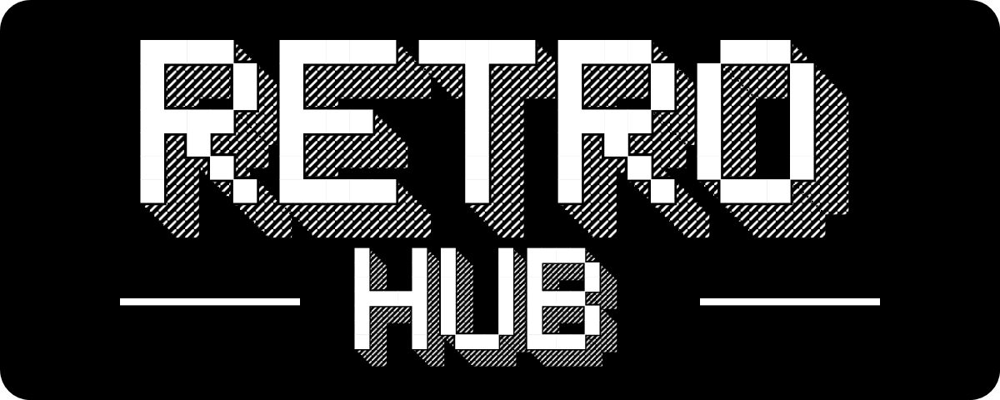
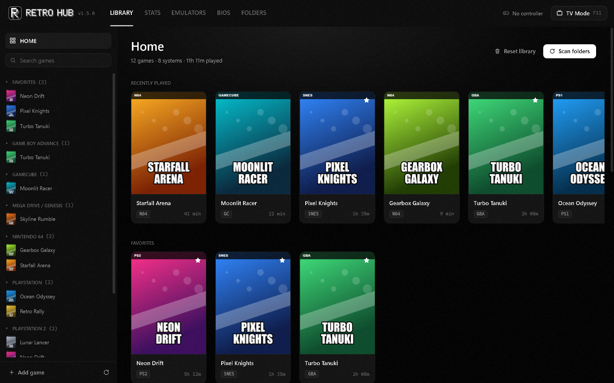
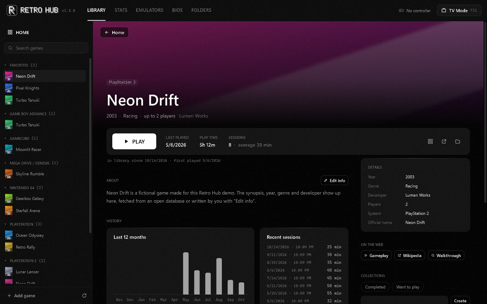
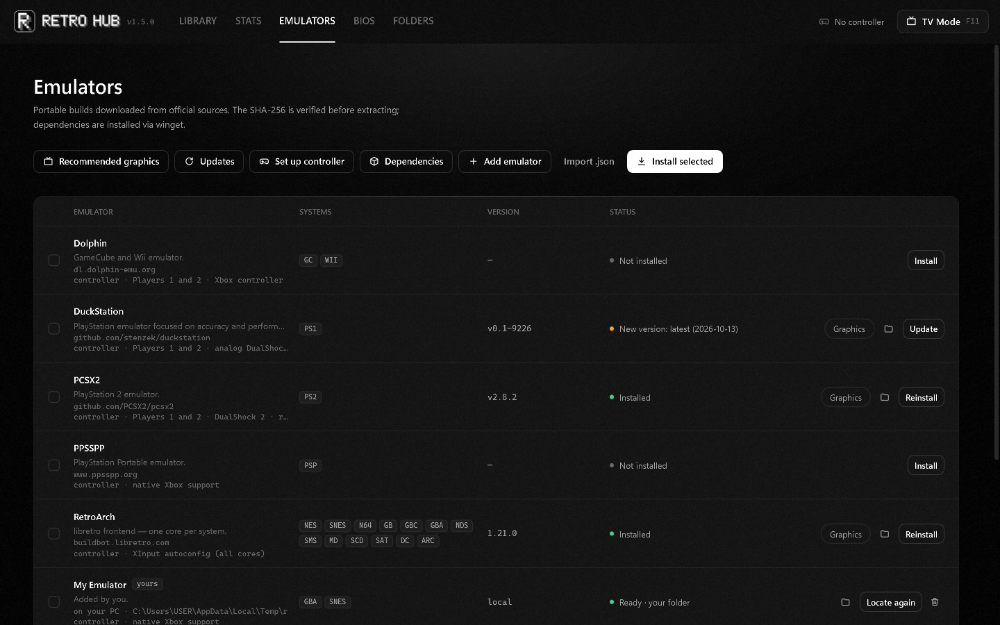
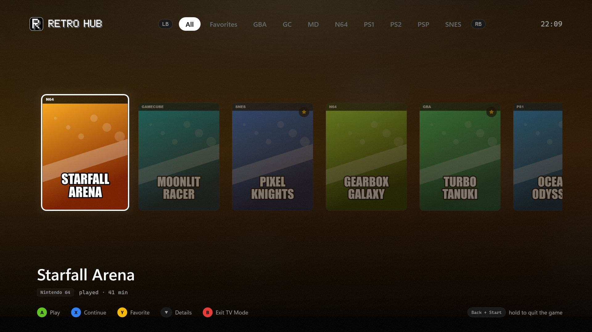
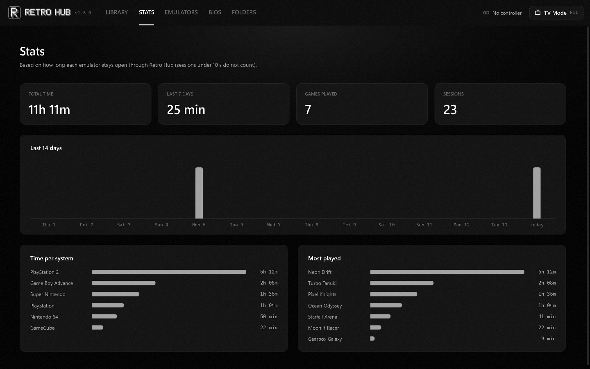
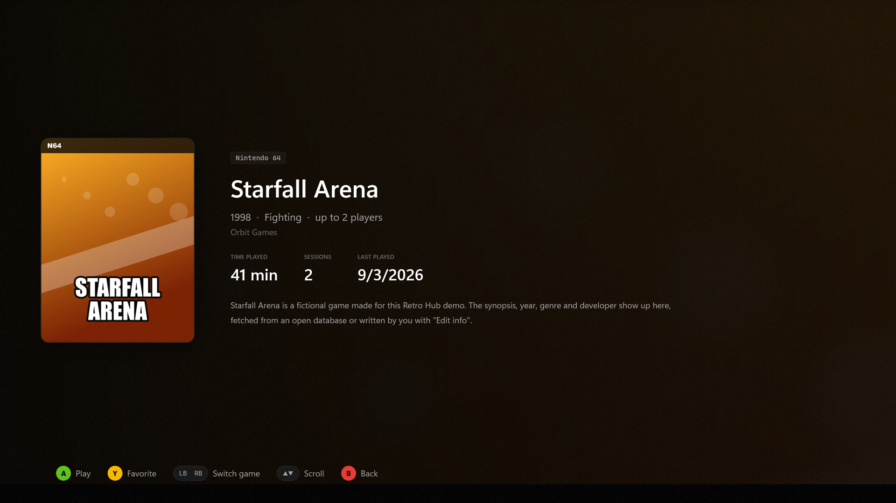

<p align="center"><b>English</b> · <a href="README.pt-BR.md">Português</a></p>

<p align="center">
  
</p>

<p align="center">
  <b>All your classic games in one place.</b><br>
  A Windows and macOS hub that installs emulators, organizes your library and opens each game in the right emulator, with a mouse or a controller.
</p>

<p align="center">
  <a href="../../releases/latest">Download</a> ·
  <a href="#getting-started">Getting started</a> ·
  <a href="#adding-emulators">Adding emulators</a> ·
  <a href="#building">Building</a> ·
  <a href="#legal">Legal</a>
</p>

---



> Screenshots use a demo library with fictional games.

## What it does

- **One-click emulators.** Downloads portable builds from official sources, checks the SHA-256 when the source publishes one, extracts and configures them. Dependencies (Visual C++) come through winget.
- **Recognizes your games.** Scans your ROM folders and works out the system from the extension, the file header (ISO 9660, CHD, GameCube/Wii, Sega…) or the folder name. Files referenced by `.cue`/`.gdi`/`.m3u` do not show up as duplicates.
- **A game-store style library.** Sidebar grouped by system and favorites, a home with recently played games, all games with sorting and filters, and a page for every game.
- **Covers and info, automatically.** Box art, title screens and in-game shots from the open libretro archive; year, genre, developer and synopsis from libretro-database. Everything is editable.
- **Xbox controller set up for you.** Players 1 and 2 are mapped in each emulator the first time a game opens in it, without undoing changes you make later.
- **TV mode.** Full screen for the couch, driven entirely by the controller.
- **Saves.** Save states with thumbnails, "continue from the last save", and a daily `.zip` backup.
- **Graphics quality.** Original / Enhanced / Maximum presets (recommended for your graphics card), internal resolution, aspect ratio, widescreen, HD textures and a CRT filter.
- **Play time and stats** per game, per system and per month.
- **RetroAchievements** in RetroArch, PCSX2 and DuckStation.
- **Your own emulators.** Point to an `.exe` you already have or import a `.json` manifest ([see below](#adding-emulators)).
- **English and Portuguese.** Pick the language in the installer or in **Folders › Preferences › Language**.

| | |
|---|---|
|  |  |
|  |  |

## Included systems and emulators

| Emulator | Systems |
|---|---|
| RetroArch (libretro cores) | NES, SNES, Nintendo 64, Game Boy / Color / Advance, Nintendo DS, Master System, Mega Drive / Genesis, Sega CD, Saturn, Dreamcast, Arcade (FinalBurn Neo) |
| DuckStation | PlayStation |
| PCSX2 | PlayStation 2 |
| PPSSPP | PlayStation Portable |
| Dolphin | GameCube, Wii |

Any other Windows emulator can be added by you.

## Getting started

1. Download the installer from [Releases](../../releases/latest) and run it. It does not ask for administrator rights and does not need .NET installed.
2. In **Folders**, add the folders that hold your ROMs, then click **Scan folders** in the **Library**.
3. In **Emulators**, click **Install selected** (or install only the ones you want).
4. If a system needs a BIOS, import your console's files in the **BIOS** screen: drag the folder or the `.zip` in and they are recognized by MD5.
5. Click a game to open its page, or double-click it to play.

Your library, emulators and saves live in `%LOCALAPPDATA%\RetroHub` and stay there after updating or uninstalling. With a `portable.txt` file next to `RetroHub.exe`, everything goes to `.\data` instead.

### BIOS

Retro Hub **does not download BIOS files**: they are copyrighted firmware. Use dumps from your own consoles.

- **Not needed:** NES, SNES, N64, GB/GBC, Master System, Mega Drive, GameCube/Wii, PSP, Arcade.
- **Work without one (emulated BIOS):** GBA, Nintendo DS and Dreamcast.
- **Need the dump:** PlayStation, PlayStation 2, Sega CD and Saturn.

### TV mode



Open it with the **TV Mode** button, **F11**, the "Retro Hub (TV mode)" shortcut or `RetroHub.exe --tv`.

| Controller | Keyboard | Action |
|---|---|---|
| ← → / stick | ← → | browse |
| LB / RB (or ↑) | PgUp / PgDn, Q / E | switch tab (All, Favorites, systems, collections) |
| ↓ | ↓ | game page (inside it: ← → switches game, ↑ ↓ scrolls, B goes back) |
| A | Enter | play |
| X | C | continue from the last save |
| Y | F | favorite |
| B | Esc | leave TV mode |
| Back + Start (hold 1 s) | — | close the game and return |

## macOS

The Mac app (`src/RetroHub.Mac`, Avalonia) has the same screens, design and features, and shares everything else with the Windows app: the core logic, the manifests and the translations.

- **Requirements:** macOS 12 or later, Apple Silicon or Intel.
- **Install:** open `RetroHub-<version>-macos-<arch>.dmg` and drag Retro Hub to Applications. Builds without a Developer ID signature show the "unidentified developer" prompt the first time: right-click the app › **Open**.
- **Data:** `~/Library/Application Support/RetroHub` (a `portable.txt` inside `Retro Hub.app/Contents/MacOS` switches to `./data` there).
- **Emulators** are the official macOS apps, downloaded into Retro Hub's folder and kept self-contained: RetroArch, PCSX2 and Dolphin in their portable mode; DuckStation and PPSSPP run with their home folder inside it.
- **PCSX2** has no Apple Silicon build yet: it runs through Rosetta 2 (the **Dependencies** button checks for it).
- **Controllers** are read through SDL3 (Xbox, PlayStation, Switch Pro and MFi controllers); RetroArch uses its MFi driver.
- **Differences:** no winget (emulators ship as app bundles), Finder and the Trash instead of Explorer and the Recycle Bin, and TV mode shows the game art instead of preview videos.

## Adding emulators

In the **Emulators** screen:

- **Add emulator**: pick the `.exe` of an emulator you already have, tick its systems and adjust the arguments. Nothing is downloaded, copied or changed in its folder, and removing it from the list does not delete its files.
- **Import .json**: bring in a full manifest, in the same format as the bundled ones (download, controller, graphics, saves).

Your manifests live in `%LOCALAPPDATA%\RetroHub\manifests` and are never deleted by updates:

```
%LOCALAPPDATA%\RetroHub\manifests\
  emulators\*.json   emulators (the same id as a bundled emulator replaces it)
  systems\*.json     new systems: { "systems": [ { "id": …, "extensions": […], … } ] }
```

### Manifest format

```jsonc
{
  "id": "my-emulator",                  // lowercase letters, numbers and hyphens
  "name": "My Emulator",
  "systems": ["snes", "gba"],           // ids from systems.json
  "source": { "type": "local", "path": "D:\\Emulators\\MyEmu\\myemu.exe" },
  // or download the latest GitHub release:
  //   { "type": "github", "repo": "owner/project", "asset": "windows.*\\.zip$" }
  // or a fixed link:
  //   { "type": "url", "version": "1.0", "url": "https://…/emu.zip", "sha256": "…" }
  "executable": "myemu.exe",            // wildcards allowed
  "launch": [
    { "systems": ["snes", "gba"], "args": "\"{rom}\" --fullscreen" }
    // placeholders: {rom} {romDir} {romName} {emuDir} {core}
  ],
  "biosDir": "bios",                    // optional: where the BIOS screen copies files
  "preserve": ["config"],               // optional: what an update never overwrites
  "controller": { … },                  // optional: automatic controller mapping
  "graphics": { … },                    // optional: quality presets and resolution
  "saves": { … },                       // optional: save states and backup
  "macos": { … }                        // optional: keys that replace the ones above on macOS
}
```

**macOS:** a `"macos"` block overrides the top-level keys it names (usually `source`, `executable`, `launch`, `controller`). Without it, a downloadable emulator only appears on Windows. Two keys help emulators that keep their data in the home folder: `"environment": { "HOME": "{emuDir}/home" }` sets variables for the emulator process, and `"dataDir"` makes the controller, graphics and save paths relative to that folder.

The manifests in [`manifests/emulators`](manifests/emulators) show every optional field in use.

**Hashes:** GitHub sources use the SHA-256 GitHub publishes for each asset. Fixed links without a hash are marked "no hash" and the computed SHA-256 is recorded; fill in `"sha256"` to require the check.

### Translations

The UI text in the code is English and is also the translation key: `L.T("Install")` in C#, `{l:T 'Install'}` in XAML. Other languages live in `src/RetroHub.App/i18n/<language>/*.json` as flat `{ "English": "Translation" }` objects; a missing entry falls back to English.

## Building

Requires the [.NET 8 SDK](https://dotnet.microsoft.com/download/dotnet/8.0) on Windows 10 or 11, or macOS.

```bash
dotnet run --project src/RetroHub.App     # Windows
dotnet run --project src/RetroHub.Mac     # macOS
```

```bash
dotnet test
```

Installer (requires [Inno Setup 6](https://jrsoftware.org/isinfo.php)):

```bash
powershell -ExecutionPolicy Bypass -File installer\build-installer.ps1
```

Produces `dist\RetroHub-Setup-<version>.exe` with a self-contained app. The version comes from `Directory.Build.props`.

macOS app and disk image:

```bash
installer/build-mac.sh            # arm64 or x64; defaults to this Mac
```

Produces `dist/Retro Hub.app` and `dist/RetroHub-<version>-macos-<arch>.dmg`, signed ad-hoc. Set `SIGN_IDENTITY="Developer ID Application: …"` to sign for distribution (with the hardened runtime), then notarize the .dmg.

`RETROHUB_NET_TESTS=1 dotnet test` on a Mac also installs the five emulators for real (~410 MB) to check the downloads, extraction and code signatures.

### Layout

```
manifests/                  declarative catalog (shipped next to the .exe)
  systems.json                systems, extensions, folder names, BIOS (MD5), covers
  dependencies.json           winget packages
  emulators/*.json            source, executable, arguments, controller, graphics, saves
src/RetroHub.Core/          logic without WPF (testable)
  Install/                    versions (GitHub/Forgejo/URL), download, SHA-256, extraction, winget, user emulators
  Scanning/                   scanner, disc headers, ISO 9660, .cue/.gdi/.m3u, titles
  Library/                    SQLite: games, sessions, collections, emulators, settings
  Launch/ Input/ Saves/       launching games, controllers (XInput/SDL), save states and backup
  Covers/ Metadata/ Bios/     covers, game info and ROM verification, BIOS by MD5
  Localization/               L.T / L.F (English keys, translations from i18n/)
src/RetroHub.App/           WPF + MVVM (CommunityToolkit.Mvvm)
  Themes/                     design tokens, icons and styles (black and white)
  Views/ ViewModels/          library, game page, emulators, BIOS, folders, TV mode
  i18n/pt-BR/                 Portuguese translation
src/RetroHub.Mac/           Avalonia + MVVM, same structure and design (macOS)
  Themes/                     the same tokens; WPF styles become ControlThemes with the same keys
  Input/                      controllers through SDL3
  i18n/pt-BR/                 Mac-only texts (Finder, Trash, Rosetta)
tests/RetroHub.Core.Tests/  xUnit with synthetic disc images
docs/                       website (GitHub Pages) and README images
```

## Legal

Retro Hub **does not include or download games, BIOS files, keys or firmware**. Only use copies you dumped yourself from games and consoles you own. Issues asking where to get ROMs or BIOS files will be closed.

Emulators are downloaded from each project's official pages, under their own licenses. Covers and game info come from open libretro archives; the artwork belongs to the publishers. Console and game names are trademarks of their owners and appear only to state compatibility. Retro Hub is not affiliated with any of these companies.

## License

[MIT](LICENSE). Third-party libraries: [THIRD-PARTY-NOTICES.md](THIRD-PARTY-NOTICES.md).
