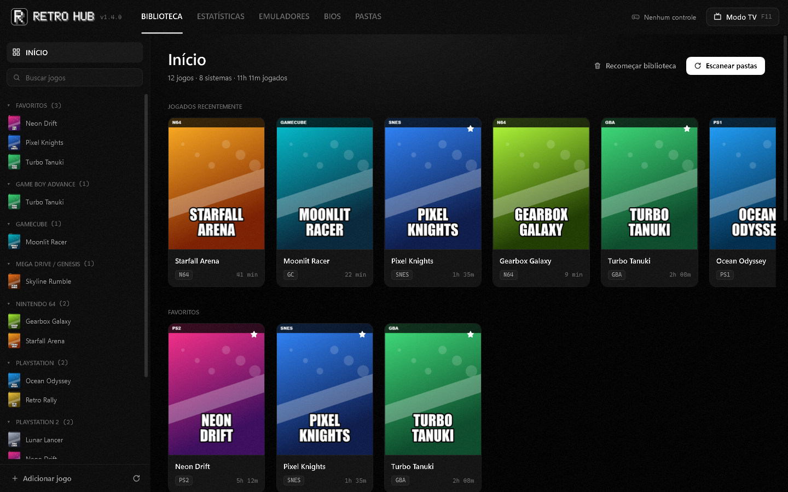
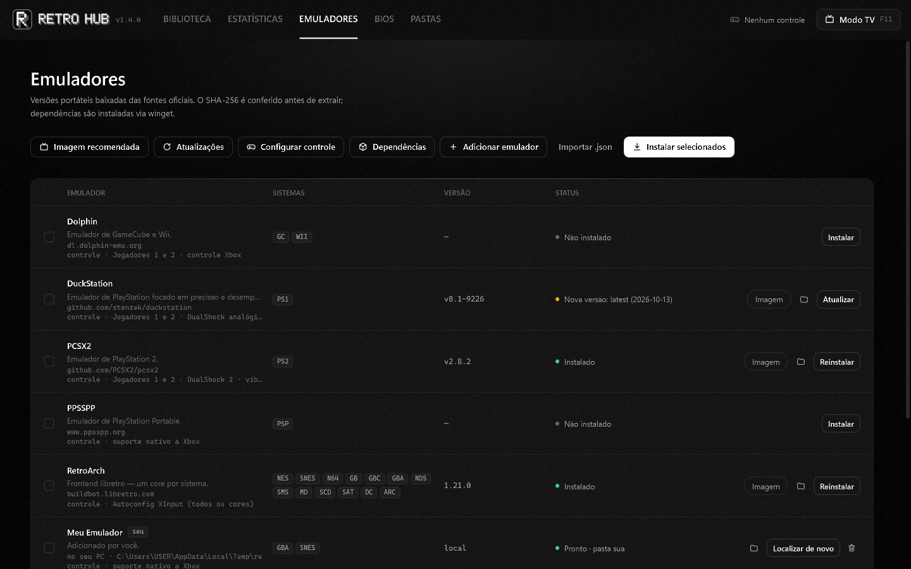
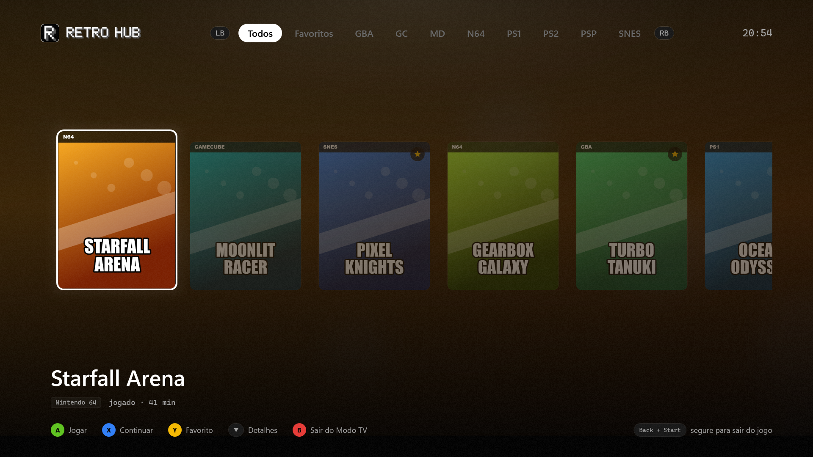
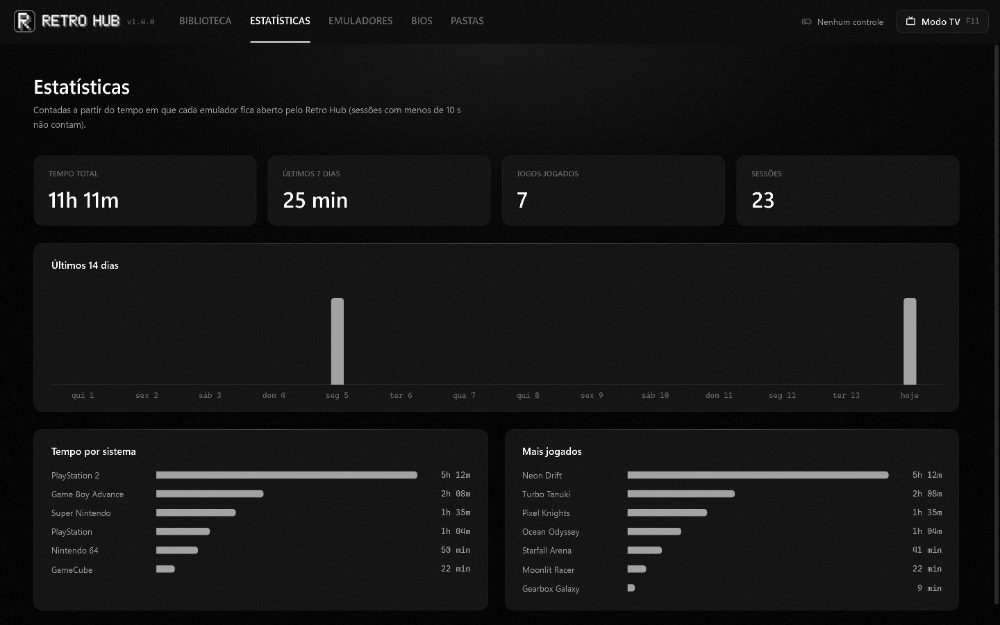
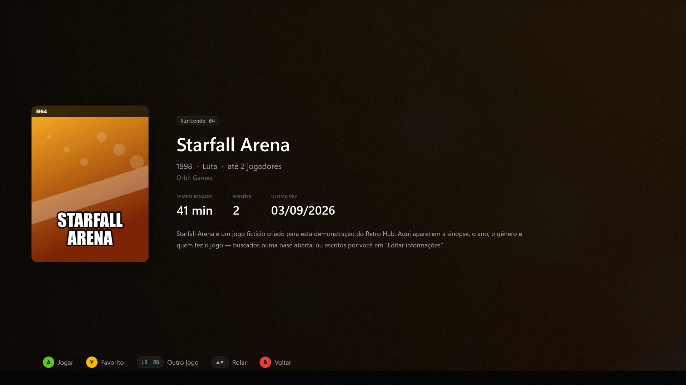

<p align="center">
  
</p>

<p align="center">
  <b>Seus jogos antigos num lugar só.</b><br>
  Um hub para Windows que instala emuladores, organiza a biblioteca e abre cada jogo no emulador certo, com mouse ou controle.
</p>

<p align="center">
  <a href="../../releases/latest">Baixar</a> ·
  <a href="#como-usar">Como usar</a> ·
  <a href="#adicionar-emuladores">Adicionar emuladores</a> ·
  <a href="#compilar">Compilar</a> ·
  <a href="#aviso-legal">Aviso legal</a>
</p>

---



> As capturas usam uma biblioteca de demonstração com jogos fictícios.

## O que ele faz

- **Instala emuladores com um clique.** Baixa as versões portáteis das fontes oficiais, confere o SHA-256 quando a fonte publica, extrai e deixa configurado. Dependências (Visual C++) vêm pelo winget.
- **Reconhece seus jogos sozinho.** Escaneia as pastas de ROMs e descobre o sistema pela extensão, pelo cabeçalho do arquivo (ISO 9660, CHD, GameCube/Wii, Sega…) ou pelo nome da pasta. Arquivos citados por `.cue`/`.gdi`/`.m3u` não viram jogos repetidos.
- **Biblioteca no estilo das lojas de jogos.** Lista lateral por sistema e favoritos, início com jogados recentemente, todos os jogos com ordenação e filtros, e uma página para cada jogo.
- **Capas e informações automáticas.** Capas, tela de título e imagens do jogo vêm do acervo aberto do libretro; ano, gênero, desenvolvedora e sinopse vêm do libretro-database. Dá para editar à mão.
- **Controle Xbox configurado sozinho.** Jogadores 1 e 2 são mapeados em cada emulador na primeira vez que um jogo abre nele, sem desfazer o que você mudar depois.
- **Modo TV.** Tela cheia para jogar no sofá, navegada só pelo controle.
- **Saves.** Lista os save states com miniatura, abre o jogo direto no último save e faz backup diário em `.zip`.
- **Qualidade de imagem.** Níveis Original / Melhorado / Máximo (recomendado conforme a sua placa de vídeo), resolução interna, proporção, widescreen, texturas HD e filtro CRT.
- **Tempo jogado e estatísticas** por jogo, por sistema e por mês.
- **Conquistas** do RetroAchievements no RetroArch, PCSX2 e DuckStation.
- **Seus próprios emuladores.** Aponte um `.exe` que você já tem ou importe um manifesto `.json` ([veja abaixo](#adicionar-emuladores)).

| | |
|---|---|
|  |  |
|  |  |

## Sistemas e emuladores incluídos

| Emulador | Sistemas |
|---|---|
| RetroArch (cores libretro) | NES, SNES, Nintendo 64, Game Boy / Color / Advance, Nintendo DS, Master System, Mega Drive, Sega CD, Saturn, Dreamcast, Arcade (FinalBurn Neo) |
| DuckStation | PlayStation |
| PCSX2 | PlayStation 2 |
| PPSSPP | PlayStation Portable |
| Dolphin | GameCube, Wii |

Qualquer outro emulador para Windows pode ser adicionado por você.

## Como usar

1. Baixe o instalador em [Releases](../../releases/latest) e instale. Ele não pede administrador e não precisa do .NET instalado.
2. Em **Pastas**, adicione as pastas onde ficam as suas ROMs e clique em **Escanear**.
3. Em **Emuladores**, clique em **Instalar selecionados** (ou instale só os que quiser).
4. Se algum sistema precisar de BIOS, importe na tela **BIOS** os arquivos do seu console: arraste a pasta ou o `.zip` e eles são reconhecidos pelo MD5.
5. Clique num jogo para ver a página dele, ou dê dois cliques para jogar.

A biblioteca, os emuladores e os saves ficam em `%LOCALAPPDATA%\RetroHub` e continuam lá depois de atualizar ou desinstalar. Com um arquivo `portable.txt` ao lado do `RetroHub.exe`, tudo vai para `.\data`.

### BIOS

O Retro Hub **não baixa BIOS**: são firmwares com direitos autorais. Use os dumps do seu console.

- **Não precisam:** NES, SNES, N64, GB/GBC, Master System, Mega Drive, GameCube/Wii, PSP, Arcade.
- **Funcionam sem, com BIOS emulada:** GBA, Nintendo DS e Dreamcast.
- **Precisam do dump:** PlayStation, PlayStation 2, Sega CD e Saturn.

### Modo TV



Abre pelo botão **Modo TV**, por **F11**, pelo atalho "Retro Hub (Modo TV)" ou com `RetroHub.exe --tv`.

| Controle | Teclado | Ação |
|---|---|---|
| ← → / analógico | ← → | navegar |
| LB / RB (ou ↑) | PgUp / PgDn, Q / E | trocar aba (Todos, Favoritos, sistemas, coleções) |
| ↓ | ↓ | página do jogo (lá dentro: ← → troca de jogo, ↑ ↓ rola, B volta) |
| A | Enter | jogar |
| X | C | continuar do último save |
| Y | F | favoritar |
| B | Esc | sair do Modo TV |
| Back + Start (segurar 1 s) | — | fechar o jogo e voltar |

## Adicionar emuladores

Na tela **Emuladores**:

- **Adicionar emulador**: escolha o `.exe` de um emulador que você já tem, marque os sistemas e ajuste os argumentos. Nada é baixado, copiado ou alterado na pasta dele, e remover da lista não apaga os arquivos.
- **Importar .json**: traga um manifesto completo, no mesmo formato dos que vêm com o app (download, controle, imagem, saves).

Os seus manifestos ficam em `%LOCALAPPDATA%\RetroHub\manifests` e não são apagados nas atualizações:

```
%LOCALAPPDATA%\RetroHub\manifests\
  emulators\*.json   emuladores (o mesmo id de um emulador do app substitui o do app)
  systems\*.json     sistemas novos: { "systems": [ { "id": …, "extensions": […], … } ] }
```

### Formato do manifesto

```jsonc
{
  "id": "meu-emulador",                 // letras minúsculas, números e hífen
  "name": "Meu Emulador",
  "systems": ["snes", "gba"],           // ids de systems.json
  "source": { "type": "local", "path": "D:\\Emuladores\\MeuEmu\\meuemu.exe" },
  // ou baixar da última release do GitHub:
  //   { "type": "github", "repo": "dono/projeto", "asset": "windows.*\\.zip$" }
  // ou de um link fixo:
  //   { "type": "url", "version": "1.0", "url": "https://…/emu.zip", "sha256": "…" }
  "executable": "meuemu.exe",           // aceita curingas
  "launch": [
    { "systems": ["snes", "gba"], "args": "\"{rom}\" --fullscreen" }
    // placeholders: {rom} {romDir} {romName} {emuDir} {core}
  ],
  "biosDir": "bios",                    // opcional: para onde a tela BIOS copia os arquivos
  "preserve": ["config"],               // opcional: o que uma atualização nunca sobrescreve
  "controller": { … },                  // opcional: mapeamento automático do controle
  "graphics": { … },                    // opcional: níveis de imagem e resolução
  "saves": { … }                        // opcional: save states e backup
}
```

Os manifestos em [`manifests/emulators`](manifests/emulators) mostram todos os campos opcionais em uso.

**Hash:** fontes do GitHub usam o SHA-256 que o GitHub publica para cada arquivo. Links fixos sem hash ficam marcados como "sem hash" e o SHA-256 obtido é registrado; preencha `"sha256"` para exigir a conferência.

## Compilar

Precisa do [.NET 8 SDK](https://dotnet.microsoft.com/download/dotnet/8.0) no Windows 10 ou 11.

```bash
dotnet run --project src/RetroHub.App
```

```bash
dotnet test
```

Instalador (precisa do [Inno Setup 6](https://jrsoftware.org/isinfo.php)):

```bash
powershell -ExecutionPolicy Bypass -File installer\build-installer.ps1
```

Gera `dist\RetroHub-Setup-<versão>.exe` com o app self-contained. A versão vem de `Directory.Build.props`.

### Estrutura

```
manifests/                  catálogo declarativo (vai para ao lado do .exe)
  systems.json                sistemas, extensões, nomes de pasta, BIOS (MD5), capas
  dependencies.json           pacotes winget
  emulators/*.json            fonte, executável, argumentos, controle, imagem, saves
src/RetroHub.Core/          lógica sem WPF (testável)
  Install/                    versões (GitHub/Forgejo/URL), download, SHA-256, extração, winget, emuladores do usuário
  Scanning/                   scanner, cabeçalhos de disco, ISO 9660, .cue/.gdi/.m3u, títulos
  Library/                    SQLite: jogos, sessões, coleções, emuladores, configurações
  Launch/ Input/ Saves/       abrir jogos, controle Xbox (XInput/SDL), save states e backup
  Covers/ Metadata/ Bios/     capas, informações e verificação de ROM, BIOS por MD5
src/RetroHub.App/           WPF + MVVM (CommunityToolkit.Mvvm)
  Themes/                     tokens de design, ícones e estilos (preto e branco)
  Views/ ViewModels/          biblioteca, página do jogo, emuladores, BIOS, pastas, Modo TV
tests/RetroHub.Core.Tests/  xUnit com imagens de disco sintéticas
docs/                       site (GitHub Pages) e imagens do README
```

## Aviso legal

O Retro Hub **não inclui e não baixa jogos, BIOS, chaves ou firmware**. Use apenas cópias que você mesmo extraiu dos seus jogos e consoles. Não abra issues pedindo onde conseguir ROMs ou BIOS: elas serão fechadas.

Os emuladores são baixados das páginas oficiais de cada projeto, sob as licenças deles. Capas e informações vêm de acervos abertos do libretro; a arte pertence às editoras. Nomes de consoles e jogos são marcas dos seus donos e aparecem só para indicar compatibilidade. O Retro Hub não tem relação com nenhuma dessas empresas.

## Licença

[MIT](LICENSE). Bibliotecas de terceiros: [THIRD-PARTY-NOTICES.md](THIRD-PARTY-NOTICES.md).
